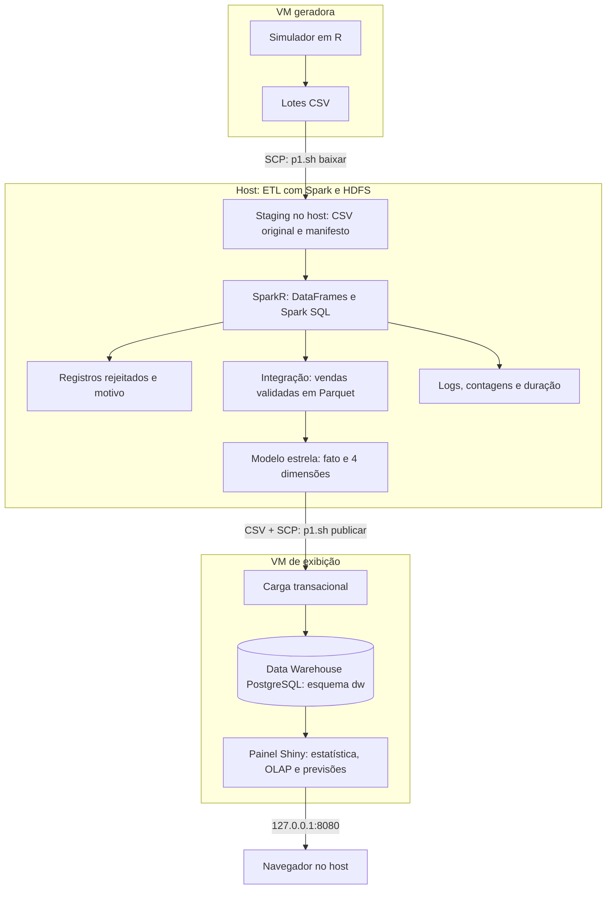

# Arquitetura do PI completo

Título geral: **Automação e escalabilidade de pipelines de Big Data e análise de dados**.
Subtítulo proposto: análise de vendas simuladas de artigos esportivos.

## Problema e decisão apoiada

Pergunta proposta: como as vendas variam por produto, canal, região e mês, e quais
informações ajudam no planejamento comercial? Confirmar o problema com o beneficiário.
Os indicadores são pedidos, itens, faturamento líquido, desconto e ticket médio.
Dados sintéticos demonstram o método, sem comprovar desempenho real da Track & Field.
O uso do nome no projeto não comprova parceria, autorização ou acesso à operação.

## Fluxo implementado

Duas VMs com papéis separados: a **geradora** produz os dados; a de **exibição**
guarda o Data Warehouse e serve o painel. O host faz o ETL com Spark e HDFS.

Escolha: **Data Warehouse**. Os dados chegam como **CSV estruturado**, com esquema fixo
e conhecido (11 colunas tipadas), e o objetivo é **análise histórica e consultas
OLAP** por produto, canal, região e tempo. Esse é o caso típico de um Data Warehouse:
esquema definido na escrita (*schema-on-write*), modelo dimensional e dados
integrados e validados antes de serem consultados. Um Data Lake se justificaria com
dados variados ou não estruturados (logs, imagens, JSON livre) guardados antes de
se definir o uso — não é o caso aqui.

O DW fica em um **PostgreSQL** na VM de exibição, no esquema `dw`: `fato_vendas`,
`dim_produto`, `dim_canal`, `dim_regiao` e `dim_data`, com chaves primárias,
estrangeiras, tipos e restrições de domínio (`dw/esquema.sql`). A visão
`dw.vw_vendas` junta a fato às dimensões para o painel, e `dw.cargas` registra
cada carga. O painel lê somente o DW.

Camadas do ETL (nomes técnicos das pastas entre parênteses):

| Camada | Pasta / local | Conteúdo |
|---|---|---|
| Staging | `bronze` (disco local e HDFS) | CSV original, entrada normalizada e manifesto, para auditoria e reprocessamento |
| Integração | `silver` (Parquet) | vendas validadas, tipadas e com totais recalculados |
| Modelo dimensional | `gold` (Parquet) e `results/bigdata/exec-*/dw/*.csv` | fato e dimensões prontas para a carga |
| Data Warehouse | PostgreSQL `dw_vendas`, esquema `dw` | tabelas consultadas pelo painel |
| Quarentena | `quarentena` (Parquet) | registros rejeitados e o motivo |

Cada processamento Spark é um retrato completo dos lotes conhecidos. A carga
(`dw/carregar.sql`) substitui o conteúdo do DW em **uma transação**: se qualquer
linha violar tipo, chave ou restrição, nada muda e a carga anterior continua ativa.

ETL: extrair CSVs da VM geradora, validar esquema e identidade, transformar no Spark,
montar o modelo estrela e carregá-lo no Data Warehouse da VM de exibição. A ingestão elimina
cópias byte a byte por MD5 (identificação de conteúdo, não mecanismo de segurança).
O Spark remove duplicatas de conteúdo normalizado e rejeita conflitos por chave.
R e Spark recalculam valores em centavos com empate para o par, normalizando
resíduos binários a seis casas de centavo antes de arredondar. Por exemplo,
15% de R$ 149,70 resulta em R$ 22,46 de desconto e R$ 127,24 líquidos.
Os CSVs originais permanecem preservados mesmo quando o total é corrigido.

## Modelo dimensional

Grão da fato: um pedido simulado por execução. Chave composta: `execucao + pedido`.
Cada pedido do simulador representa um produto. Dimensões e fato usam os mesmos
campos e funções para gerar suas chaves.

| Tabela | Chave | Conteúdo |
|---|---|---|
| fato_vendas | execução e pedido | chaves das dimensões, cliente (dimensão degenerada), quantidade, preço, desconto, valores bruto, desconto e líquido |
| dim_produto | hash de produto e categoria | produto e categoria |
| dim_canal | hash do canal | canal de venda |
| dim_regiao | hash da região | região |
| dim_data | AAAAMMDD | data, ano, mês e trimestre |

Não há identificação real de clientes. O identificador sintético de cliente se
repete entre lotes e não sustenta análises de recompra ou retenção.

## Hadoop e escala

Hadoop e Spark fazem o **processamento (ETL)**; o PostgreSQL é o **armazenamento
analítico (DW)**. Essa divisão é comum: o cluster transforma volumes grandes e o
Data Warehouse serve consultas rápidas ao modelo já integrado.

Modo `local`: Spark lê e escreve no sistema de arquivos local. Modo `hdfs`: as
camadas de staging, integração, modelo dimensional e a quarentena ficam no HDFS. Há um NameNode e um
DataNode com replicação 1, em um único host, acessíveis apenas em loopback.
É uma demonstração pseudodistribuída: não fornece redundância, tolerância à perda
do host nem evidência de desempenho de um cluster com vários servidores.

Spark executa em `local[2]`, com dois threads. Usa DataFrames e SQL de verdade,
inclusive verificação da equivalência de um agrupamento nas duas APIs. Hadoop
armazena e Spark processa. YARN e Hive não são necessários nesta configuração.
O modo local do Spark é intencional para caber no computador de apresentação.

| Conceito | Relação com o caso proposto | Limite da demonstração |
|---|---|---|
| Volume | histórico de vendas de muitos canais e lojas | os lotes pequenos não são Big Data por si só |
| Velocidade | chegada recorrente de lotes | processamento batch, sem streaming |
| Variedade | categorias, canais, locais e datas | entrada atual é CSV estruturado |
| Veracidade | rejeições, duplicidades e validação dos totais | dados sintéticos e regras simplificadas |
| Valor | indicadores que apoiam planejamento | benefício real depende da validação com o beneficiário |

Para múltiplos servidores seriam necessários endereços de rede apropriados,
autenticação, permissões, replicação, backup, gerenciador de recursos e medição
de carga. A configuração em loopback não deve ser apresentada como produção.
O estágio de ingestão usa R e lê um arquivo por vez em memória. O painel carrega
do DW todas as vendas da carga; para volumes muito maiores, ele deveria consultar
agregados no PostgreSQL em vez de trazer a fato inteira.

## Infraestrutura das VMs

| VM | Papel | Configuração (Ansible) | Portas no host |
|---|---|---|---|
| geradora | simulador R, lotes CSV | R, pastas de dados | SSH 2222 |
| exibicao | Data Warehouse e painel | PostgreSQL, papel `pi`, banco `dw_vendas`, esquema, pacotes R, serviço `pi-painel` | SSH 2223, painel 8080 |

As duas VMs são criadas pelo OpenTofu (`for_each` em `infraestrutura/main.tf`),
usam a mesma imagem Ubuntu verificada e a mesma chave SSH dedicada, e só expõem
portas em `127.0.0.1`. O PostgreSQL aceita apenas conexões locais da VM,
autenticadas pelo usuário do sistema (`peer`): não há senha no projeto.

## Arquivos principais

| Arquivo | Função |
|---|---|
| R/lotes.R | ingestão, identidade por conteúdo e leitura da última execução |
| scripts/pipeline_bigdata.sh | sequência, bloqueio de concorrência e monitoramento |
| spark/processar.R | tratamento, SQL, DataFrames, Parquet, modelo dimensional e exportação para o DW |
| dw/esquema.sql | tabelas, chaves, restrições e visão do Data Warehouse |
| dw/carregar.sql | carga transacional do DW a partir do modelo estrela |
| infraestrutura/p1.sh | VMs, geração de dados e publicação no DW (`publicar`) |
| infraestrutura/ansible/playbook.yml | configuração das duas VMs e serviço do painel |
| scripts/publicar_spark.R | conferência R/Spark e relatório da execução |
| infraestrutura/bigdata/ | instalação e ciclo de vida do HDFS |
| R/dw.R | leitura do Data Warehouse pelo painel |
| R/painel.R | resultados, fonte dos dados e última carga do DW |

Referências técnicas: [SparkR 3.5.8](https://spark.apache.org/docs/3.5.8/sparkr.html)
e [Hadoop 3.4.2 em um nó](https://hadoop.apache.org/docs/r3.4.2/hadoop-project-dist/hadoop-common/SingleCluster.html).
Requisitos acadêmicos: documento de orientação PI 2026-2, páginas 7–11 do PDF.
